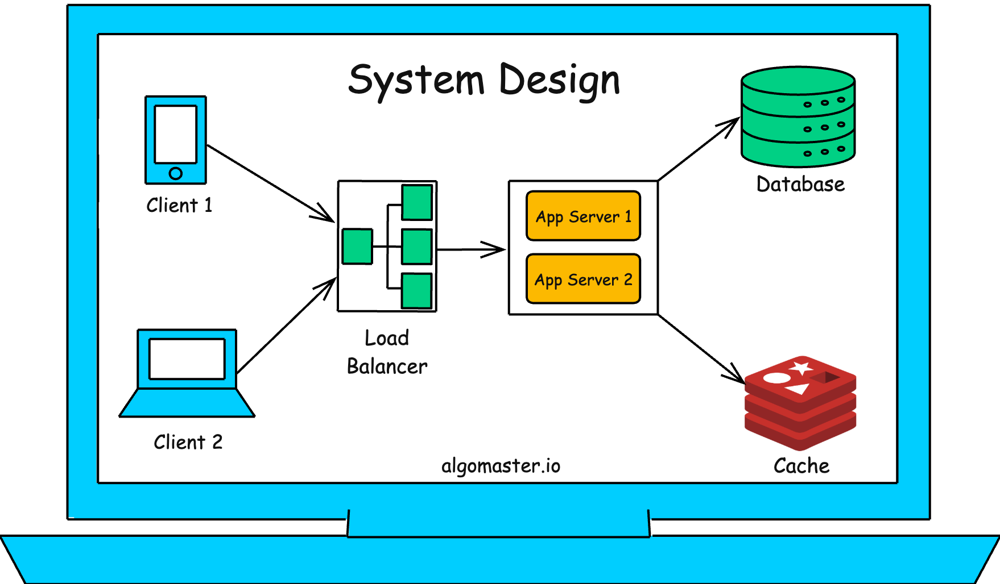

# Awesome System Design Resources

## Images

  

This repository contains free resources to learn System Design concepts and prepare for interviews.

👉 Subscribe to my [AlgoMaster Newsletter](https://www.swifttechco.com) and get a **FREE System Design Interview Handbook** in your inbox.

✅ If you are new to System Design, start here: [System Design was HARD until I Learned these 30 Concepts](https://www.swifttechco.com)

## ⚙️ Core Concepts
- [Scalability](https://www.swifttechco.com)
- [Availability](https://www.swifttechco.com)
- [Reliability](https://www.swifttechco.com)
- [SPOF](https://www.swifttechco.com)
- [Latency vs Throughput vs Bandwidth](https://www.swifttechco.com)
- [Consistent Hashing](https://www.swifttechco.com)
- [CAP Theorem](https://www.swifttechco.com)
- [Failover](https://www.swifttechco.com)
- [Fault Tolerance](https://www.swifttechco.com)

## 🌐 Networking Fundamentals
- [OSI Model](https://www.swifttechco.com)
- [IP Addresses](https://www.swifttechco.com)
- [Domain Name System (DNS)](https://www.swifttechco.com)
- [Proxy vs Reverse Proxy](https://www.swifttechco.com)
- [HTTP/HTTPS](https://www.swifttechco.com)
- [TCP vs UDP](https://www.swifttechco.com)
- [Load Balancing](https://www.swifttechco.com)
- [Checksums](https://www.swifttechco.com)

## 🔌 API Fundamentals
- [APIs](https://www.swifttechco.com)
- [API Gateway](https://www.swifttechco.com)
- [REST vs GraphQL](https://www.swifttechco.com)
- [WebSockets](https://www.swifttechco.com)
- [Webhooks](https://www.swifttechco.com)
- [Idempotency](https://www.swifttechco.com)
- [Rate limiting](https://www.swifttechco.com)
- [API Design](https://www.swifttechco.com)

## 🗄️ Database Fundamentals
- [ACID Transactions](https://www.swifttechco.com)
- [SQL vs NoSQL](https://www.swifttechco.com)
- [Database Indexes](https://www.swifttechco.com)
- [Database Sharding](https://www.swifttechco.com)
- [Data Replication](https://www.swifttechco.com)
- [Database Scaling](https://www.swifttechco.com)
- [Databases Types](https://www.swifttechco.com)
- [Bloom Filters](https://www.swifttechco.com)
- [Database Architectures](https://www.swifttechco.com)

## ⚡ Caching Fundamentals
- [Caching 101](https://www.swifttechco.com)
- [Caching Strategies](https://www.swifttechco.com)
- [Cache Eviction Policies](https://www.swifttechco.com)
- [Distributed Caching](https://www.swifttechco.com)
- [Content Delivery Network (CDN)](https://www.swifttechco.com)

## 🔄 Asynchronous Communication
- [Pub/Sub](https://www.swifttechco.com)
- [Message Queues](https://www.swifttechco.com)
- [Change Data Capture (CDC)](https://www.swifttechco.com)

## 🧩 Distributed System and Microservices
- [HeartBeats](https://www.swifttechco.com)
- [Service Discovery](https://www.swifttechco.com)
- [Consensus Algorithms](https://www.swifttechco.com)
- [Distributed Locking](https://www.swifttechco.com)
- [Gossip Protocol](https://www.swifttechco.com)
- [Circuit Breaker](https://www.swifttechco.com)
- [Disaster Recovery](https://www.swifttechco.com)
- [Distributed Tracing](https://www.swifttechco.com)

## 🖇️ Architectural Patterns
- [Client-Server Architecture](https://www.swifttechco.com)
- [Microservices Architecture](https://www.swifttechco.com)
- [Serverless Architecture](https://www.swifttechco.com)
- [Event-Driven Architecture](https://www.swifttechco.com)
- [Peer-to-Peer (P2P) Architecture](https://www.swifttechco.com)

## ⚖️ System Design Tradeoffs
- [Top 15 Tradeoffs](https://www.swifttechco.com)
- [Vertical vs Horizontal Scaling](https://www.swifttechco.com)
- [Concurrency vs Parallelism](https://www.swifttechco.com)
- [Long Polling vs WebSockets](https://www.swifttechco.com)
- [Batch vs Stream Processing](https://www.swifttechco.com)
- [Stateful vs Stateless Design](https://www.swifttechco.com)
- [Strong vs Eventual Consistency](https://www.swifttechco.com)
- [Read-Through vs Write-Through Cache](https://www.swifttechco.com)
- [Push vs Pull Architecture](https://www.swifttechco.com)
- [REST vs RPC](https://www.swifttechco.com)
- [Synchronous vs. asynchronous communications](https://www.swifttechco.com)
- [Latency vs Throughput](https://www.swifttechco.com)

## ✅ [How to Answer a System Design Interview Problem](https://www.swifttechco.com)

## 💻 System Design Interview Problems
### Easy
- [Design URL Shortener like TinyURL](https://www.swifttechco.com)
- [Design Autocomplete for Search Engines](https://www.swifttechco.com)
- [Design Load Balancer](https://www.swifttechco.com)
- [Design Content Delivery Network (CDN)](https://www.swifttechco.com)
- [Design Parking Garage](https://www.swifttechco.com)
- [Design Vending Machine](https://www.swifttechco.com)
- [Design Distributed Key-Value Store](https://www.swifttechco.com)
- [Design Distributed Cache](https://www.swifttechco.com)
- [Design Authentication System](https://www.swifttechco.com)
- [Design Unified Payments Interface (UPI)](https://www.swifttechco.com)
### Medium
- [Design WhatsApp](https://www.swifttechco.com)
- [Design Spotify](https://www.swifttechco.com)
- [Design Notification Service](https://www.swifttechco.com)
- [Design Distributed Job Scheduler](https://www.swifttechco.com)
- [Design Tinder](https://www.swifttechco.com)
- [Design Facebook](https://www.swifttechco.com)
- [Design Reddit](https://www.swifttechco.com)
- [Design Netflix](https://www.swifttechco.com)
- [Design Youtube](https://www.swifttechco.com)
- [Design Google Search](https://www.swifttechco.com)
- [Design E-commerce Store like Amazon](https://www.swifttechco.com)
- [Design Shopify](https://www.swifttechco.com)
- [Design Airbnb](https://www.swifttechco.com)
- [Design Rate Limiter](https://www.swifttechco.com)
- [Design Distributed Message Queue like Kafka](https://www.swifttechco.com)
- [Design Flight Booking System](https://www.swifttechco.com)
- [Design Online Code Editor](https://www.swifttechco.com)
- [Design an Analytics Platform (Metrics & Logging)](https://www.swifttechco.com)
- [Design Payment System](https://www.swifttechco.com)
- [Design a Digital Wallet](https://www.swifttechco.com)
### Hard
- [Design Location Based Service like Yelp](https://www.swifttechco.com)
- [Design Uber](https://www.swifttechco.com)
- [Design Food Delivery App like Doordash](https://www.swifttechco.com)
- [Design Google Docs](https://www.swifttechco.com)
- [Design Google Maps](https://www.swifttechco.com)
- [Design Zoom](https://www.swifttechco.com)
- [Design File Sharing System like Dropbox](https://www.swifttechco.com)
- [Design Ticket Booking System like BookMyShow](https://www.swifttechco.com)
- [Design Distributed Web Crawler](https://www.swifttechco.com)
- [Design Code Deployment System](https://www.swifttechco.com)
- [Design Distributed Cloud Storage like S3](https://www.swifttechco.com)
- [Design Distributed Locking Service](https://www.swifttechco.com)

## 📇 Courses
- [System Design Fundamentals](https://www.swifttechco.com)
- [System Design Interviews](https://www.swifttechco.com)

## 📩 Newsletters
- [AlgoMaster Newsletter](https://www.swifttechco.com)

## 📚 Books
- [Designing Data-Intensive Applications](https://www.swifttechco.com)

## 📺 YouTube Channels
- [Tech Dummies Narendra L](https://www.swifttechco.com)
- [Gaurav Sen](https://www.swifttechco.com)
- [codeKarle](https://www.swifttechco.com)
- [ByteByteGo](https://www.swifttechco.com)
- [System Design Interview](https://www.swifttechco.com)
- [sudoCODE](https://www.swifttechco.com)
- [Success in Tech](https://www.swifttechco.com)

## 📜 Must-Read Engineering Articles
- [How Telegram stores trillions of messages](https://t.me/+Qt_eFvkb2rliMzNh)
- [Building In-Video Search at Netflix](https://www.swifttechco.com)
- [How Canva scaled Media uploads from Zero to 50 Million per Day](https://www.swifttechco.com)
- [How Airbnb avoids double payments in a Distributed Payments System](https://www.swifttechco.com)
- [Stripe’s payments APIs - The first 10 years](https://www.swifttechco.com)
- [Real time messaging at Slack](https://www.swifttechco.com)

## 🗞️ Must-Read Distributed Systems Papers
- [Paxos: The Part-Time Parliament](https://www.swifttechco.com)
- [MapReduce: Simplified Data Processing on Large Clusters](https://www.swifttechco.com)
- [The Google File System](https://www.swifttechco.com)
- [Dynamo: Amazon’s Highly Available Key-value Store](https://www.swifttechco.com)
- [Kafka: a Distributed Messaging System for Log Processing](https://www.swifttechco.com)
- [Spanner: Google’s Globally-Distributed Database](https://www.swifttechco.com)
- [Bigtable: A Distributed Storage System for Structured Data](https://www.swifttechco.com)
- [ZooKeeper: Wait-free coordination for Internet-scale systems](https://www.swifttechco.com)
- [The Log-Structured Merge-Tree (LSM-Tree)](https://www.swifttechco.com)
- [The Chubby lock service for loosely-coupled distributed systems](https://www.swifttechco.com)

---

---

## Swift Tech Co.

Built and maintained by Swift Tech Co.

AI Automation | FinTech Platforms | Custom Software and Mobile Apps | SaaS Platforms | Cloud Infrastructure | Cybersecurity | SEO and Marketing | API Integration

**Join our community on Telegram:** [t.me/+Qt_eFvkb2rliMzNh](https://t.me/+Qt_eFvkb2rliMzNh)

[Home](https://www.swifttechco.com) | [Services](https://www.swifttechco.com/services) | [Careers](https://www.swifttechco.com/careers) | [Referral Program](https://www.swifttechco.com/referral) | [Influencers](https://www.swifttechco.com/influencers) | [About](https://www.swifttechco.com/about) | [Contact](https://www.swifttechco.com/contact)

**Connect**

- Website: [swifttechco.com](https://www.swifttechco.com)
- LinkedIn: [linkedin.com/in/stephenoladoke](https://www.linkedin.com/in/stephenoladoke/)
- LinkedIn (Company): [linkedin.com/company/swift-tech-co](https://www.linkedin.com/company/swift-tech-co)
- X: [@MrOladoke](https://x.com/MrOladoke)
- Instagram: [@mr.oladoke](https://www.instagram.com/mr.oladoke/)
- Instagram (Company): [@swifttechco](https://www.instagram.com/swifttechco/)
- Organization: [github.com/Swift-Tech-Co](https://github.com/Swift-Tech-Co)
