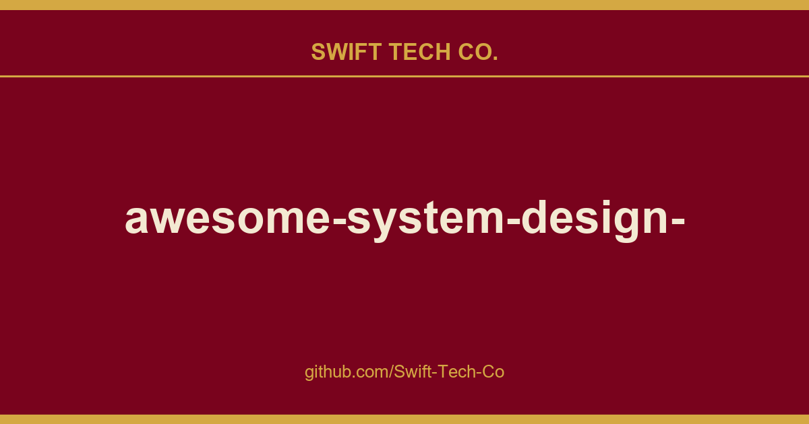

# awesome-system-design-resources

## What This Is

This is part of the Swift Tech Co. working stack for product and engineering. It gathers the awesome-system-design-resources notes, examples and fixes that keep delivery fast, and doubles as the reference map we hand to whoever picks up this thread next.

## Images

## ⚙️ Core Concepts
- Scalability
- Availability
- Reliability
- SPOF
- Latency vs Throughput vs Bandwidth
- Consistent Hashing
- CAP Theorem
- Failover
- Fault Tolerance

## 🌐 Networking Fundamentals
- OSI Model
- IP Addresses
- Domain Name System (DNS)
- Proxy vs Reverse Proxy
- HTTP/HTTPS
- TCP vs UDP
- Load Balancing
- Checksums

## 🔌 API Fundamentals
- APIs
- API Gateway
- REST vs GraphQL
- WebSockets
- Webhooks
- Idempotency
- Rate limiting
- API Design

## 🗄️ Database Fundamentals
- ACID Transactions
- SQL vs NoSQL
- Database Indexes
- Database Sharding
- Data Replication
- Database Scaling
- Databases Types
- Bloom Filters
- Database Architectures

## ⚡ Caching Fundamentals
- Caching 101
- Caching Strategies
- Cache Eviction Policies
- Distributed Caching
- Content Delivery Network (CDN)

## 🔄 Asynchronous Communication
- Pub/Sub
- Message Queues
- Change Data Capture (CDC)

## 🧩 Distributed System and Microservices
- HeartBeats
- Service Discovery
- Consensus Algorithms
- Distributed Locking
- Gossip Protocol
- Circuit Breaker
- Disaster Recovery
- Distributed Tracing

## 🖇️ Architectural Patterns
- Client-Server Architecture
- Microservices Architecture
- Serverless Architecture
- Event-Driven Architecture
- Peer-to-Peer (P2P) Architecture

## ⚖️ System Design Tradeoffs
- Top 15 Tradeoffs
- Vertical vs Horizontal Scaling
- Concurrency vs Parallelism
- Long Polling vs WebSockets
- Batch vs Stream Processing
- Stateful vs Stateless Design
- Strong vs Eventual Consistency
- Read-Through vs Write-Through Cache
- Push vs Pull Architecture
- REST vs RPC
- Synchronous vs. asynchronous communications
- Latency vs Throughput

## ✅ How to Answer a System Design Interview Problem

## 💻 System Design Interview Problems
### Easy
- Design URL Shortener like TinyURL
- Design Autocomplete for Search Engines
- Design Load Balancer
- Design Content Delivery Network (CDN)
- Design Parking Garage
- Design Vending Machine
- Design Distributed Key-Value Store
- Design Distributed Cache
- Design Authentication System
- Design Unified Payments Interface (UPI)
### Medium
- Design WhatsApp
- Design Spotify
- Design Notification Service
- Design Distributed Job Scheduler
- Design Tinder
- Design Facebook
- Design Reddit
- Design Netflix
- Design Youtube
- Design Google Search
- Design E-commerce Store like Amazon
- Design Shopify
- Design Airbnb
- Design Rate Limiter
- Design Distributed Message Queue like Kafka
- Design Flight Booking System
- Design Online Code Editor
- Design an Analytics Platform (Metrics & Logging)
- Design Payment System
- Design a Digital Wallet
### Hard
- Design Location Based Service like Yelp
- Design Uber
- Design Food Delivery App like Doordash
- Design Google Docs
- Design Google Maps
- Design Zoom
- Design File Sharing System like Dropbox
- Design Ticket Booking System like BookMyShow
- Design Distributed Web Crawler
- Design Code Deployment System
- Design Distributed Cloud Storage like S3
- Design Distributed Locking Service

## 📇 Courses
- System Design Fundamentals
- System Design Interviews

## 📩 Newsletters
- AlgoMaster Newsletter

## 📚 Books
- Designing Data-Intensive Applications

## 📺 YouTube Channels
- Tech Dummies Narendra L
- Gaurav Sen
- codeKarle
- ByteByteGo
- System Design Interview
- sudoCODE
- Success in Tech

## 📜 Must-Read Engineering Articles
- [How Telegram stores trillions of messages](https://t.me/+Qt_eFvkb2rliMzNh)
- Building In-Video Search at Netflix
- How Canva scaled Media uploads from Zero to 50 Million per Day
- How Airbnb avoids double payments in a Distributed Payments System
- Stripe’s payments APIs - The first 10 years
- Real time messaging at Slack

## 🗞️ Must-Read Distributed Systems Papers
- Paxos: The Part-Time Parliament
- MapReduce: Simplified Data Processing on Large Clusters
- The Google File System
- Dynamo: Amazon’s Highly Available Key-value Store
- Kafka: a Distributed Messaging System for Log Processing
- Spanner: Google’s Globally-Distributed Database
- Bigtable: A Distributed Storage System for Structured Data
- ZooKeeper: Wait-free coordination for Internet-scale systems
- The Log-Structured Merge-Tree (LSM-Tree)
- The Chubby lock service for loosely-coupled distributed systems

---

---

## Swift Tech Co.

Built and maintained by Swift Tech Co.

AI Automation | FinTech Platforms | Custom Software and Mobile Apps | SaaS Platforms | Cloud Infrastructure | Cybersecurity | SEO and Marketing | API Integration

**Join our community on Telegram:** [t.me/+Qt_eFvkb2rliMzNh](https://t.me/+Qt_eFvkb2rliMzNh)

Home | Services | Careers | Referral Program | Influencers | About | Contact

**Connect**

- Website: swifttechco.com
- LinkedIn: [linkedin.com/in/stephenoladoke](https://www.linkedin.com/in/stephenoladoke/)
- LinkedIn (Company): [linkedin.com/company/swift-tech-co](https://www.linkedin.com/company/swift-tech-co)
- X: [@MrOladoke](https://x.com/MrOladoke)
- Instagram: [@mr.oladoke](https://www.instagram.com/mr.oladoke/)
- Instagram (Company): [@swifttechco](https://www.instagram.com/swifttechco/)
- Organization: [github.com/Swift-Tech-Co](https://github.com/Swift-Tech-Co)

## Sources

Compiled and maintained from upstream [ashishps1/awesome-system-design-resources](https://github.com/ashishps1/awesome-system-design-resources) under permissive open-source license.

---

Maintained by [Swift Tech Co.](https://github.com/Swift-Tech-Co) - [Telegram](https://t.me/+Qt_eFvkb2rliMzNh)